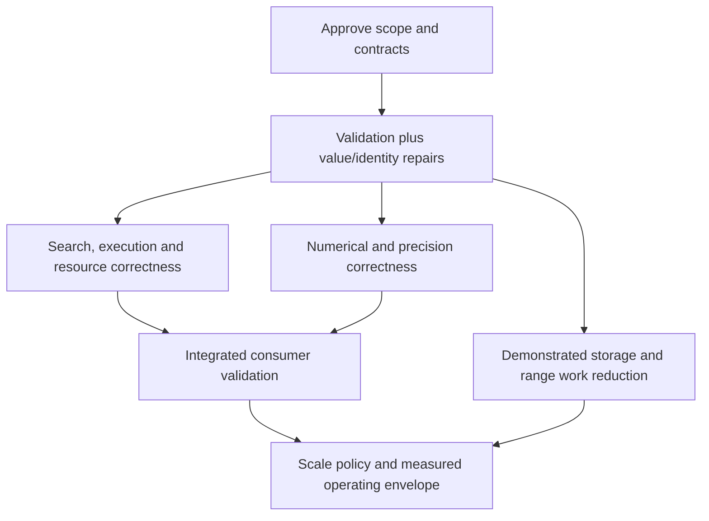

# VectorCore stabilization — planning draft

> **Planning only.** The user explicitly requested that implementation not begin. No item in this document authorizes code changes, implementation-agent dispatch, commits, publication or sibling-repository edits. When execution is authorized, use `superpowers:subagent-driven-development` for an approved, bounded task brief.

**Date:** September 18, 2026.  
**Goal:** make the supported VectorCore APIs dependable, then establish measured operating limits for downstream production workloads.  
**Architecture:** preserve the validated audit as evidence; resolve contracts centrally; implement and review bounded defect classes in dependency order. Independent agents use **`gpt-6-astra`, reasoning `medium`**; the orchestrator owns architecture, numerical policy, severity and release decisions.  
**Tech stack:** Swift 6, Swift Testing/XCTest, C/Accelerate, Python CI tooling and optional downstream Metal integration.  
**Requirements:** [validated audit](../../../audits/2026-09-14/README.md), the user's AGENTS.md claim discipline, and the explicit planning-only instruction. This draft is a proposed program, not an approved implementation specification.

## Documents

- [Findings and severity](FINDINGS.md): all 131 records, original confidence/priority, practical impact, disposition and one primary work-item owner.
- [Work-item catalog](WORK_ITEMS.md): bounded candidate scopes, source files, regression requirements, dependencies and design questions. These are not dispatch-ready implementation briefs.
- [Agent workflow](AGENT_WORKFLOW.md): model settings, context budget, review gates, conflict prevention and evidence format.
- [Planning decisions](DECISIONS.md): orchestrator rulings, dependency interpretation and independent review corrections.
- [Shared source files](SHARED_FILES.md): potential conflicts to resolve before assigning write ownership.
- [Tracking data](tracking.json): machine-readable ownership and dependency mapping; every item starts `planned`, with execution authorization `false`.

The 131 records overlap and include opportunities, context, three unverified concerns and one rejected inference. They are not 131 separate bugs. The historical audit remains unchanged; future fixes receive separate closure records linking back to it.

## Current baseline

The checkout remains at `8b02e75bca7055ae11170873d15c06f1538709b7`, version 0.3.3. On September 18, the audit checker verified all 355 tracked-file hashes and 91 retained evidence files. No new runtime tests or benchmarks were run for this planning task. September 14's passing Release suite remains historical evidence, not proof that the audited defects are fixed.

The audit, original review and new plan are currently untracked. An execution checkout must receive the exact approved documents and required evidence explicitly; creating a worktree from HEAD alone will not contain them. Preserve unrelated `.antigravitycli/` and `GEMINI.md` files. Repository changes, dependency versions and available agent slots must be checked again when execution starts.

## What “stable” means

### Milestone A — dependable supported behavior

- [ ] Define the supported API/provider/precision/platform matrix and the release's compatibility policy.
- [ ] Close every P1 finding with regression evidence, including benchmark correctness and optional public cache correctness.
- [ ] Close confirmed correctness, safety, data-loss and resource-ownership failures on supported paths, including applicable P2/P3 boundary cases. Low priority alone is not a reason to retain wrong results in a supported feature.
- [ ] Give qualified findings an explicit contract decision; prove the chosen behavior. Keep dormant code unreachable until its prerequisites pass.
- [ ] Establish numerical domain/nonfinite policies and independently validate public routes and route boundaries.
- [ ] Pass appropriate Debug/Release, external-consumer, selected sanitizer and platform checks on the integrated revision. Record skipped/unavailable checks explicitly.
- [ ] Recheck pinned VectorIndex/VectorAccelerate consumers for changed contracts; test CPU and GPU paths separately where relevant.

If a defect cannot be repaired in this milestone, an explicit scope/compatibility decision is required. Merely documenting a known failure does not close it. Disabling or withdrawing a supported API is a compatibility change, not an automatic workaround.

### Milestone B — a supported scale envelope

- [ ] Specify vector count N, simultaneous queries Q, dimensions, precision/metrics, worker concurrency, target hardware, memory budget and latency/throughput goals.
- [ ] Remove demonstrated work amplification in storage mutation and FP16 range wrappers.
- [ ] Enforce chosen cache, scratch-memory and outstanding-work budgets; specify failure/backpressure behavior when budgets cannot be met.
- [ ] Compare direct and accelerated distance policies around near-equal/large-offset inputs; validate provider precedence across automatic route gates.
- [ ] Publish representative Release timing distributions plus allocation, peak and retained memory measurements with reproducible provenance.

Milestone A does not imply million-vector or GPU readiness. Milestone B cannot be signed off until the workload and budget are chosen. The audit's 40 GB score-matrix example is a sizing illustration, not the target workload.

## Twelve planning workstreams

| Stream | Scope | Main outcome |
|---|---|---|
| V | Validation and measurement | Fail invalid/missing work; truthful reports and comparable measurements. |
| S | Public shape and decoded invariants | Consistent dimension/storage contracts before unsafe access. |
| O | Storage and pointer ownership | Isolated values, exactly-once destruction, correct borrowing and bounded copying. |
| I | Hints and cache identity | Metadata follows values; cache hits identify the exact intended data. |
| R | Search, collections and matrix semantics | Requested metrics, correct membership/scores and transactional updates. |
| E | Execution and resource control | Valid arithmetic, bounded scheduling, atomic settings and owned pools. |
| N | Scalar/vector numerical behavior | Range-safe division, normalization, comparison, statistics and entropy. |
| Q | Reduced precision | Defined quantization/accuracy policy, correct diagnostics and bounded range work. |
| L | Linear algebra and manifolds | Valid factors, calibrated equations and explicit conditioning/domain limits. |
| P | Search and batch scalability | Streaming work, packing reuse and deliberate exactness/memory policy. |
| B | Serialization | Valid round trips, real tests and compatible documented wire contracts. |
| D | Downstream/API contracts | Real consumer routes, supported surfaces and evidence-backed documentation. |

Workstreams are ownership categories, not twelve giant agent assignments. Each catalog item can be split at its design checkpoint when a reviewer could independently accept one change and reject another. Shared source files remain exclusive to one implementer at a time.

## Proposed sequence

The diagram is the program outline; `tracking.json` contains the item dependencies. Dependencies on measurement mean **before claiming a speed improvement**, not that an unrelated correctness regression must wait for every benchmark cleanup.

### First batch to design and review

1. **V01 — strict benchmark correctness and failure propagation.** Define successful validation and machine-readable failure before later performance acceptance.
2. **O01 — compact storage copy isolation and destruction.** Close shared-owner and generic-element lifetime defects together; cover every compact count and tier boundaries. Include the adjacent singleton import regression without claiming to fix higher-tier copying.
3. **R01 — search metric preservation.** Preserve the actual supported metric instance; test score and membership against its direct witness. Resolve scalar mismatch behavior before choosing an implementation.
4. **I01 — normalization hint invalidation.** Define direct/nested mutation and throwing-exit behavior. Core repair and downstream consumer validation are separate closure stages.

These areas have largely separate source ownership. Start with at most **two implementers**, reserving capacity for an independent reviewer. Do not dispatch all four together. S01 (shape), I02 (cache identity) and the numerical domain decisions should be designed at the same time by the orchestrator, because they constrain later repairs.

### Ordering that must not be reversed

- Fix compact ownership before optimizing triangular mutation. Prove bulk writeback on ordinary and throwing exits **before** routing public fills through it.
- Establish public shape invariants before treating derived metadata or unsafe aggregation assumptions as trustworthy.
- Repair chunk/config arithmetic and scheduling behavior before connecting previously ignored live settings. Audit everything newly reachable, including optional helpers.
- Define ownership of cached versus checked-out buffers before adding pool teardown or changing return behavior.
- Use exact cache identity; full-coordinate hashing alone is insufficient. Count retained identity snapshots in any byte budget.
- Establish independent numerical references before reusing existing entropy/factorization tests as acceptance gates.
- Close scalar/precision contracts before measuring a new route as an improvement. An Accelerate primitive substitution is not itself evidence of numerical repair.
- Set metric-specific result semantics before changing selection/packing paths. Preserve existing NaN/tie laws on selectors that already define them.

## Decisions for the planning review

| Decision | Draft recommendation | Effect |
|---|---|---|
| Compatibility | Preserve source/wire compatibility where practical; separately propose unavoidable breaks. User preference is pending. | Shape setters, existential metric signatures and pointer getters may require migration design. |
| Public mutation | Fixed-width values preserve count; dynamic dimension follows owned storage. Decide whether invalid legacy writes trap, throw through a checked API or are deprecated. | Do not hide invalid input by silently truncating/padding it. |
| Throwing mutable borrow | Prefer preserving writes already performed, consistently across storage tiers; invalidate hints before mutation. | Confirm existing documented rollback promises before adoption. |
| Cache identity | Prefer immutable value snapshot plus equality after hashing unless a consumer-backed versioned identity design is justified. | Snapshot retention adds bytes and must enter cache accounting. |
| Numerical domain | State zero/nonfinite/overflow policy per operation; preserve finite direction where the normalized result is representable. | Test tolerances and scaled references are part of the design, not adjustable until tests pass. |
| Metric and score contract | Use the supplied supported metric witness; define score conversion using metric semantics. | No universal `1/(1+d)` promise for arbitrary signed distances. |
| Precision selection | Define whether requested accuracy is a bound or heuristic, including zero-reference behavior and fallback. | Do not activate ignored controls without validating new routes. |
| Resource policy | Specify total retained bytes, checked-out bytes, scratch and pending-work limits separately. | A count limit alone is not a memory budget. |
| Release/platform envelope | Name API families, sibling revisions and target hardware/workloads. | Leave untested products/platforms explicitly unverified. |

These are proposed decisions for review, not implemented behavior. Routine task-local choices can later be made by the orchestrator within the approved contract. Compatibility changes and release-scope changes must remain visible.

## Global constraints for future task briefs

- **Do not execute this planning draft.** Implementation requires a later user go-ahead and an orchestrator-approved bounded brief.
- Every worker and independent agent reviewer uses **`gpt-6-astra` with `reasoning_effort: "medium"`**. Do not silently raise effort or change models. Escalate difficult reasoning to the orchestrator.
- Preserve the package's current platform floors: macOS 14, iOS/tvOS 17, watchOS 10, visionOS 1; Swift tools 6.0. Changes require an explicit design decision.
- Add no third-party dependency merely to repair these findings.
- Keep the historical audit and its evidence unchanged. Record closures separately with fixing revision and test evidence.
- A robustness claim must cite a test, follow directly from adjacent code, or be explicitly unverified.
- Repeated defect classes require mechanical family coverage; one reproduced case is insufficient closure.
- Any routing/configuration change requires a fresh reachability review of the code it exposes.
- Preserve established wire bytes, SoA ownership/layout contracts and existing defined NaN/tie semantics unless an approved migration changes them.
- No shared-file edits by parallel implementers; no nested agent fan-out; no automatic push, merge, release or sibling-repository mutation.

## Planning checks completed

- [x] Current tracked source matches the reviewed revision.
- [x] Original confidence distinctions and corrections retained.
- [x] Each audit record assigned one primary owner and a disposition.
- [x] Dependencies, first-batch candidates and shared-file scheduling rule documented.
- [x] Astra/medium model policy and orchestrator review responsibility documented.
- [ ] Resolve compatibility and target workload preferences.
- [ ] Approve first-batch contracts and produce dispatch-ready briefs with concrete failing regressions and commands.
- [ ] Obtain implementation go-ahead; no implementation has begun.
